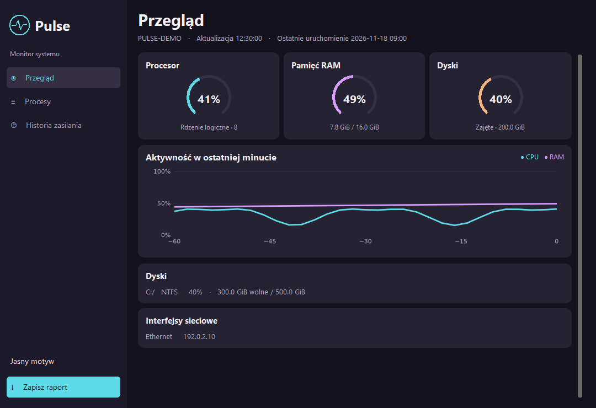
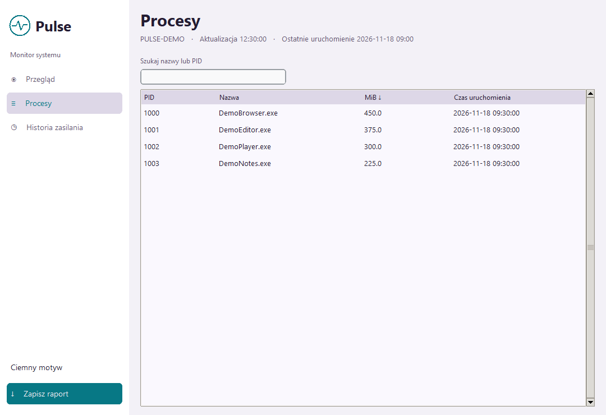

# Pulse · Diagnostyka komputera

Pulse to aplikacja do monitorowania wydajności komputera z systemem Windows. Wskaźniki pierścieniowe pokazują bieżące wykorzystanie zasobów. Na wykresie obciążenia procesora i wykorzystania pamięci RAM widać, jak długo utrzymywał się wzrost obciążenia. Interfejs jest dostępny po polsku, w jasnym i ciemnym motywie.

## Uruchomienie

Na komputerze z systemem Windows i Pythonem 3.12 (z programem uruchamiającym `py`) kliknij dwukrotnie **Start.cmd**. Przy pierwszym uruchomieniu skrypt tworzy lokalne środowisko `.venv` i instaluje zależności. Kolejne uruchomienia korzystają z tego środowiska. Aby wykonać te kroki ręcznie, otwórz PowerShell w folderze projektu.

```powershell
py -3.12 -m venv .venv
.\.venv\Scripts\python.exe -m pip install -r requirements.txt
.\.venv\Scripts\python.exe monitor.py
```

## VS Code Insiders

W folderze projektu uruchom `code-insiders Pulse.code-workspace` lub wybierz w edytorze **File → Open Folder…** i wskaż folder projektu. Przy pierwszym otwarciu zainstaluj zalecane rozszerzenia **Python** i **Python Debugger**, jeśli ich brakuje.

Naciśnij **F5**, aby uruchomić Pulse z debuggerem. Edytor najpierw przygotuje środowisko Python 3.12 w `.venv`. **Ctrl+F5** uruchamia aplikację bez debuggera. Testy znajdziesz w panelu **Testing**.

## Funkcje

- **Przegląd.** Odczyty obciążenia procesora i wykorzystania pamięci RAM są odświeżane mniej więcej co dwie sekundy. Wykres przedstawia oba pomiary z ostatnich 60 sekund na wspólnej skali procentowej. Dla każdego dostępnego woluminu aplikacja podaje system plików, procent zajętego miejsca, ilość wolnego miejsca i całkowitą pojemność. W sekcji sieciowej znajdziesz lokalne adresy IPv4 aktywnych interfejsów.
- **Procesy.** Lista jest uporządkowana malejąco według wykorzystania pamięci fizycznej. Aby znaleźć proces, wpisz fragment jego nazwy lub identyfikator PID. Kreska w kolumnie czasu uruchomienia oznacza, że system Windows nie udostępnił tej informacji.
- **Historia zasilania.** Pulse wyświetla do 200 ostatnich zdarzeń związanych z zasilaniem z dziennika System i odświeża listę raz na minutę. Zdarzenie 12 oznacza uruchomienie systemu Windows, a zdarzenie 13 oznacza początek jego zamykania. Przy zdarzeniach 41 i 6008 widoczny jest czas zarejestrowania problemu przez system. Może on przypadać na kolejne uruchomienie komputera. Zakres historii zależy od wpisów zachowanych w dzienniku.
- **Raport systemowy.** Wybierz **Zapisz raport** u dołu panelu bocznego, aby zapisać bieżące dane i dostępną historię zasilania w pliku JSON z datą w nazwie. Raport zawiera nazwę komputera, lokalne adresy IP i listę uruchomionych procesów.

Domyślne pliki `Pulse-*.json` i zawartość folderu `reports/` są pomijane przez Git. Jeśli zmieniasz nazwę raportu, zapisz go w tym folderze lub poza repozytorium.

## Zrzuty ekranu

Oba widoki przedstawiają dane demonstracyjne.





## Struktura projektu

Aplikację uruchamia plik `monitor.py`. Biblioteka CustomTkinter odpowiada za interfejs, Matplotlib rysuje wykres, a psutil odczytuje liczniki systemowe. Przy pierwszym otwarciu zakładki aplikacja tworzy jej widok. Podczas nawigacji ukrywa poprzedni widok i ponownie pokazuje wybrany. Zmiana motywu przebudowuje interfejs, zachowując próbki wykresu i tekst wyszukiwania.

Moduł `metrics.py` zbiera pomiary i odczytuje dziennik zdarzeń systemu Windows za pomocą PowerShell. Te dwa zadania działają w osobnych wątkach. Teksty interfejsu znajdują się w pliku `strings.py`, a pierwszy prototyp WPF w folderze `legacy/powershell/`.

## Testy

Po przygotowaniu środowiska uruchom testy zbierania pomiarów i odczytu zdarzeń na danych przykładowych.

```powershell
.\.venv\Scripts\python.exe -m unittest discover -s tests -v
```

## Plan prac i przypomnienia · 7–20 listopada 2026

Proponowany dwutygodniowy harmonogram prac nad projektem do portfolio.

| Termin | Zadanie | Co sprawdzić |
| --- | --- | --- |
| 7–8 listopada | Naszkicować panel, zaplanować układ przeglądu i dobrać kolory. | Sprawdzić czytelność wartości procentowych i podpisów w obu motywach. |
| 9–10 listopada | Zebrać dane o procesorze, pamięci RAM, woluminach i sieci. | Przetestować aplikację na komputerze z kilkoma interfejsami sieciowymi i pustym czytnikiem kart. |
| 11–12 listopada | Dodać wykres z przesuwającym się zakresem czasu oraz odczyt danych w tle. | Pozostawić aplikację otwartą przez ponad minutę i sprawdzić, czy najstarsze próbki znikają za lewą krawędzią wykresu. |
| 13–14 listopada | Wyświetlić procesy, ich identyfikatory PID i czas uruchomienia. | Otworzyć Notatnik, wyszukać go po nazwie, a następnie zamknąć i sprawdzić, czy znika z listy. |
| 15–16 listopada | Dodać historię zasilania. | Porównać czas wpisu, identyfikator zdarzenia i źródło z zapisem w dzienniku System. |
| 17–18 listopada | Dopracować polskie komunikaty i dodać eksport do formatu JSON. | Sprawdzić treść komunikatów, anulować zapis, a następnie ponownie otworzyć okno zapisu i zapisać raport. |
| 19–20 listopada | Sprawdzić uruchamianie i przygotować prezentację. | Uruchomić aplikację przez `Start.cmd`, otworzyć każdą sekcję i porównać zapisany raport z danymi w panelu. |

